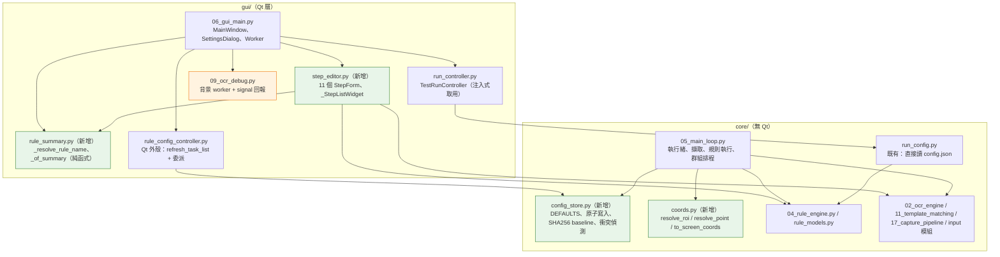

# 最終重構實作計畫（Final Refactoring Plan）

> **狀態**：實作前最終查核完成。本文件為唯讀查核的產出，尚未修改任何程式碼。
> **查核基準**：工作目錄 `C:\Code play first\ocr-trigger-clicker`，commit `e3b3dd3`。
> **查核日期**：2026-10-30
> **產出方式**：所有結論皆來自實際原始碼定位（`file:line`）。凡未經程式碼證實者，一律標示為「未驗證」而非事實。

---

## 0. 摘要：本輪查核推翻的四項既有結論

前兩輪報告有四處結論與實際程式碼不符。本計畫以查核後的事實為準。

| # | 既有結論 | 查核後事實 | 證據 |
|---|---|---|---|
| 1 | Core 透過 `RuleConfigController` 讀取設定，「保留 `interaction_mode` / `scan_interval_ms` 的**執行期間即時讀取**」 | **不存在即時讀取。** `load_config` 命中快取後直接回傳，`reset_cache()` 從未被 MainLoop 呼叫。設定值在**每個 owner 實例首次讀取時凍結**。設定視窗改動 `scan_interval_ms` 對執行中的主循環**無效** | `gui/rule_config_controller.py:64-99`；`core/05_main_loop.py` 全文無 `reset_cache` 呼叫；`tests/test_rule_config_controller.py:157-173` 明確斷言「外部修改後快取仍為舊值」 |
| 2 | `RuleConfigController` 只有 21 個 `get_setting` 呼叫點，且全是 `interaction_mode` | 前輪數字也不符。實測 `core/05_main_loop.py` 內共 **20 處** `get_setting`：**19 處**在 `MainLoop` 本體（讀 **3 種** key：`interaction_mode` 17、`scan_interval_ms` 1、`observation_shadow_enabled` 1），另 1 處是 self-check 的 stub（`:3083`） | `core/05_main_loop.py:429, 613, 625, 632, 646, 657, 706, 1192, 1429, 1455, 1476, 1498, 1514, 1549, 1773, 2625, 2666, 2672, 2887`（MainLoop 本體）+ `:3083`（self-check stub） |
| 3 | MainLoop 有「80+ instance attributes」，屬於狀態集中 | 實測 `__init__` 內賦值 **26 個** attribute，全類別觸及 **56 個**，`MainLoop` 共 **88 個方法**、4031 行。**沒有 80+ 屬性的問題** | AST 解析 `core/05_main_loop.py`（`ast.ClassDef` → `__init__` → `self.X =`） |
| 4 | Step Editor 搬移需在 `gui/step_editor.py` 與 `gui/step_editor/__init__.py` 之間擇一 | **只能選 `gui/step_editor.py`**（單一模組檔）。`build.py` 的打包 glob 會把套件形式壓平，`gui/step_editor/__init__.py` 在凍結後會落到 `gui/__init__.py`，`load_sibling` 必然 `ImportError` | `build.py:91-94`（`for f in (here / "gui").rglob("*.py"): datas.append((str(f), "gui"))`）；`_loader.py:24-30`（`target = _here / filename` + `spec_from_file_location`） |

**另有三項新發現的既存缺陷**（本次查核順帶確認，屬「不懶惰的地方：防止資料遺失／安全性」範疇）：

- **OCR Debug 背景執行緒直接操作 Qt 元件**：`gui/09_ocr_debug.py:446-447` 在非 GUI 執行緒呼叫 `self._capture_btn.setText/setEnabled`。
- **OCR Debug 的 `_ocr_busy` 是唯寫死碼**：`gui/09_ocr_debug.py:144, 432, 449` 三處賦值，**全文無任何讀取**。
- **OCR Debug 的 `clear_results()` 未使在途結果失效**：`gui/09_ocr_debug.py:1338-1344` 未遞增 `_request_id`，切換任務時在途 OCR 結果仍會回填舊資料。

---

## 1. ConfigStore 抽離

### 1.1 現況事實

**`RuleConfigController`（`gui/rule_config_controller.py`，229 行）同時承擔三種責任：**

| 責任 | 行號 | 是否需要 Qt |
|---|---|---|
| 設定檔讀寫（快取、SHA256 baseline、原子寫入、外部修改衝突偵測） | 44-197 | **否** |
| 任務清單刷新（`refresh_task_list`） | 199-229 | **是**（`Qt.ItemDataRole.ToolTipRole` @ 204） |
| 預設值字典（`DEFAULTS`，**20 個 key**） | 20-42 | 否 |

**PyQt 是 Core 對 GUI 的實際耦合點**：`gui/rule_config_controller.py:6` 的 `from PyQt6.QtCore import Qt` 被 `core/05_main_loop.py:34` 拖進 Core → **Core 目前無法在沒有 PyQt6 的環境下載入**。

**設定檔路徑來源**：
- `gui/06_gui_main.py:4749` → `self._config_path = get_data_path("config.json")`
- 經 `gui/06_gui_main.py:7600` → `InitWorker(config_path=...)` → `gui/06_gui_main.py:4327` → `MainLoop(config_path=...)` → `core/05_main_loop.py:262, 268` → `self._config_path`
- `RuleConfigController.load_config(win)` 讀 `win._config_path`（`gui/rule_config_controller.py:65`）。MainLoop 傳入的 `win` 就是 MainLoop 自身（`core/05_main_loop.py:429` 等），因此 **Core 端只需要「一個檔案路徑字串」**。

**四個獨立的 controller 實例（各自一份快取）：**

| 實例 | 位置 | 執行緒 |
|---|---|---|
| `InitWorker._rule_config_ctrl` | `gui/06_gui_main.py:4317` | 背景 |
| `SettingsDialog._ctrl` | `gui/06_gui_main.py:4369` | GUI |
| `MainWindow._rule_config_ctrl` | `gui/06_gui_main.py:4780` | GUI |
| `MainLoop._rule_config_ctrl` | `core/05_main_loop.py:399` | worker |

→ 四份快取互相看不到對方的寫入。**這就是「設定改了不生效」的根因**，而非讀取點的問題。

**`DEFAULTS` 未涵蓋但實際被讀寫的 key**（導致 `get_setting` 可能回傳 `None`）：
- `interaction_mode` — **不在 DEFAULTS**。`get_setting(self, "interaction_mode")` 在 config.json 缺此 key 時回傳 `None`。`core/05_main_loop.py:2666` 因此寫成 `in (None, "pynput")`。
- `power_save_mode` — 寫於 `gui/06_gui_main.py:4611`，不在 DEFAULTS。
- `last_task` — 寫於 `gui/06_gui_main.py:5515`，不在 DEFAULTS。

### 1.2 設定讀取點完整清單

**Core 端（`core/05_main_loop.py`）**

| 行號 | Key | 所屬方法 | 呼叫時機 | 需要即時更新？ |
|---|---|---|---|---|
| 429 | `observation_shadow_enabled` | `_is_obs_shadow_enabled` | 每次 detect 步驟（`_shadow_check_ocr` @435） | 實務上否（DEBUG-only，開啟時才有意義） |
| 613, 625, 632, 646, 657, 706, 1192, 1429, 1455, 1476, 1498, 1514, 1549, 1773, 2666, 2672, 2887 | `interaction_mode` | `_capture` / `_can_perform_action` / `_handle_click` / `_handle_drag` / `_show_sum` / 主循環 | 每幀 / 每動作 | **使用者期望即時，實作上被快取凍結** |
| 2625 | `scan_interval_ms` | 主循環 `_loop` | **每幀**（2624-2627） | 註解寫「允許即時生效」，但實作被快取凍結 → **註解與實作不符（既存缺陷）** |

**GUI 端（`gui/06_gui_main.py`）**
`MainWindow`：4326 `max_cps`、5318 `notify_resource_warn`、5341/5404/5415/5524/7617 `interaction_mode`、5728-5736 錄製預設值、6755-6784 步驟預設值、7730/7745 `set_setting("interaction_mode", "pynput")`。
`SettingsDialog`：4382-4553 共 20 個 `get_setting`（設定頁讀取 + 寫入，`_ctrl` 為獨立實例）。

**透過其他物件間接讀取**：無。`core/run_config.py:110 get_config_interaction_mode()` 會**直接讀檔**（不經 controller、無快取），被 `gui/09_ocr_debug.py:340, 428, 1082`、`gui/run_controller.py:36` 使用；`core/run_config.py:95 get_config_power_save()` 同理。**這是既有分歧點**：debug 面板與 run_controller 看到的是「檔案現值」，主循環看到的是「實例快取」。

### 1.3 三方案比較

| | A. Core ConfigStore | B. Application 層 Provider | C. Core 接收讀取介面 |
|---|---|---|---|
| 消除 Core→GUI 依賴 | ✅ | ✅ | ✅ |
| 保留既有快取語意 | ✅（每 owner 一實例） | ✅ | ✅ |
| 引入 DI / Protocol | ❌ 不需要 | ⚠️ 需定義 Provider 介面 | ⚠️ 需定義 Protocol |
| 新增檔案 | 1 | 0～1 | 0～1 |
| 與既有 `core/run_config.py` 一致性 | ✅ 同層同風格 | ⚠️ 設定讀取分散兩處 | ⚠️ 同 |
| 測試可獨立 | ✅ | ✅ | ✅ |

### 1.4 推薦方案：**A — `core/config_store.py`（單一模組、無 Protocol、無 DI）**

理由：
1. Core 對 GUI 的耦合**只有 PyQt 一個 import**（`gui/rule_config_controller.py:6`），而 PyQt 只被 `refresh_task_list`（199-229）用到。把 44-197 行的純資料邏輯搬到 `core/config_store.py`，GUI 檔案退化成「Qt 外殼 + 委派」，即可單點切斷循環。
2. 專案既有風格已是 `core/run_config.py`（純函式讀寫 JSON，無 Qt、無 Protocol）。新增 `core/config_store.py` 是同一風格的延伸，**不引入新架構概念**。
3. 方案 B/C 都需要定義一個「設定讀取介面」，但目前只有一個實作、兩個呼叫端，屬「為了抽象化而抽象化」，違反 AGENTS.md「不做沒被要求的抽象層」。

**最小可行設計：**

```python
# core/config_store.py（新增）
class ConfigStore:
    DEFAULTS = { ... }                       # 由 gui/rule_config_controller.py:20-42 原樣搬入，20 個 key
    def __init__(self): ...                  # 快取 / baseline 狀態，與現行 44-50 同構
    def reset_cache(self) -> None: ...
    def load(self, path: str) -> dict: ...   # 由現行 load_config(win) 去掉 win 參數
    def save(self, path: str, data: dict) -> bool: ...   # 由 save_config(win, data) 去掉 win 參數
    def get(self, path: str, key: str, default=None): ...
    def set(self, path: str, key: str, value) -> bool: ...
    def get_load_error(self) -> RuleFileError | None: ...
    def get_save_conflict(self) -> RuleFileError | None: ...
```

**唯一行為差異**：現行 `load_config(win)` 會讀 `win._config_path`；新 API 顯式收 `path`。呼叫端需把 `win._config_path` 傳進去。**這不是行為改變，是把隱式依賴顯式化**。

**GUI 端保留原簽名，零呼叫點改動：**

```python
# gui/rule_config_controller.py（改寫後）
class RuleConfigController(ConfigStore):
    def load_config(self, win):        return super().load(str(win._config_path))
    def save_config(self, win, data):  return super().save(str(win._config_path), data)
    def get_setting(self, win, key, default=None):
        return super().get(str(win._config_path), key, default)
    def set_setting(self, win, key, value):
        return super().set(str(win._config_path), key, value)
    def refresh_task_list(self, win):  # 原 199-229 不變（唯一需要 Qt 的部分）
        ...
```

→ **GUI 端 41 處 `_rule_config_ctrl` 引用（`gui/06_gui_main.py`）全部不需要修改。**

**Core 端改動（19 處機械替換）：**
```python
# core/05_main_loop.py
- _rule_config = load_sibling("rule_config_controller", "gui/rule_config_controller.py")
- RuleConfigController = _rule_config.RuleConfigController
+ _config_store = load_sibling("config_store", "core/config_store.py")
+ ConfigStore = _config_store.ConfigStore

- self._rule_config_ctrl = RuleConfigController()
+ self._config_store = ConfigStore()

- self._rule_config_ctrl.get_setting(self, "interaction_mode")
+ self._config_store.get(self._config_path, "interaction_mode")
```
（19 處；`observation_shadow_enabled` 保留第三參數 `False`。）

### 1.5 關於「即時生效」的明確裁決

| 項目 | 現況事實 | 本計畫決策 |
|---|---|---|
| `interaction_mode` | 呼叫點在熱路徑（每幀 2 次），但**值被實例快取凍結** | **Phase 1 保持原語意**（不變速、不變行為）。另立 **Phase 5（行為變更，需使用者核准）** 處理 |
| `scan_interval_ms` | 每幀讀取，註解宣稱即時生效，實作不即時 | Phase 1 只修註解與事實不符；即時生效納入 Phase 5 |
| `observation_shadow_enabled` | 每 detect 步驟讀取，實作同樣被凍結 | **Phase 1 保持原語意**。此為 DEBUG-only 開關（`core/05_main_loop.py:437` 以 `isEnabledFor(logging.DEBUG)` 閘控），重啟後生效可接受；在設定頁補一行「需重新啟動才生效」說明即可 |
| 路徑切換 | `RuleConfigController` 有 `_config_baseline_path` 守衛（`:66, :168-170`） | Phase 1 完整保留於 `ConfigStore`（同樣以 `path` 為鍵） |

**為什麼不順手把「即時生效」一起修**：那是**使用者可見的行為變更**（改設定後主循環行為立刻不同），混在重構裡會讓「重構前後等價」無法驗證。AGENTS.md 要求每個獨立任務單獨 commit —— 分開做才能各自驗收。

---

## 2. Step Editor 獨立化

### 2.1 檔案結構擇一：`gui/step_editor.py`（單一模組檔）

**理由（硬證據）**：`build.py:91-94`

```python
for f in (here / "gui").rglob("*.py"):
    if "__pycache__" in str(f):
        continue
    datas.append((str(f), "gui"))     # ← dest 一律是 "gui"，不含相對子目錄
```

`--add-data=<src>;gui` 會把 `gui/step_editor/__init__.py` 放到 **`gui/__init__.py`**。凍結後 `load_sibling("step_editor", "gui/step_editor/__init__.py")` 會因 `_loader.py:24-30` 的 `target.exists()` 為 False 而拋 `ImportError`。

→ **只能用 `gui/step_editor.py`。** 另需 `gui/rule_summary.py`（見 2.3），同樣是單一模組檔。

### 2.2 完整符號搬移清單

**A. 搬移到 `gui/step_editor.py`（Step Editor 專屬）**

| 符號 | 現址（`gui/06_gui_main.py`） | 引用位置 |
|---|---|---|
| `_set_form_row_visible` | 152-161 | 1687, 1688, 2028, 2029, 2767-2774, 3839, 3840（皆在 StepForm 內） |
| `_NoWheelSpin` | 130-134 | 1105, 1133, 1806, 1813, 2550, 2573, 2579, 2585, 2594, 3269, 3275, 3282, 3383, 3389, 3395, 3403, 3485, 3490, 3497, 3935, 3942, 3981（皆在 StepForm 內） |
| `_NoWheelDoubleSpin` | 135-139 | 1093, 1197, 1901, 2463, 2621, 3587（皆在 StepForm 內） |
| `_KeyCombo` | 104-129 | 510（僅 `_make_key_combo` 使用） |
| `_STEP_TYPE_ICONS` | 202-214 | 733 |
| `_STEP_TYPE_LABELS` | 216-228 | 739 |
| `_STEP_COLORS` | 230-242 | 734 |
| `_populate_rule_combo` | 254-270 | 1226, 1930, 2689, 3668, 4005（皆在 StepForm 內） |
| `_fmt_roi` | 272-277 | 302, 334, 352, 420, 1080, 1668, 1779, 2037, 2859, 3566, 3809, 3866, 3890 |
| `_fmt_capture_size` | 279-287 | 1331 |
| `_fmt_point` | 289-293 | 3245, 3316, 3372, 3434 |
| `_step_summary` | 295-422 | 746 |
| `_make_key_combo` | 509-595 | 1246, 1949, 2701, 3703, 3928, 4072 |
| `_DragHandle` | 601-632 | 725 |
| `_StepListWidget` | 634-988 | 5124（MainWindow 唯一引用點） |
| `_MatchImageStepForm` | 990-1742 | 927 |
| `_DetectStepForm` | 1744-2087 | 887 |
| `_VerifyPickImageLabel` | 2089-2110 | 2140 |
| `_VerifyTextPickDialog` | 2112-2345 | 3094 |
| `_VerifyWidget` | 2347-3202 | 3290, 3409, 3503 |
| `_ClickStepForm` | 3204-3331 | 898 |
| `_DragStepForm` | 3333-3449 | 941 |
| `_ScrollStepForm` | 3451-3527 | 956 |
| `_CompareStepForm` | 3529-3841 | 970 |
| `_SumStepForm` | 3843-3903 | 981 |
| `_KeyStepForm` | 3905-3971 | 913 |
| `_WaitStepForm` | 3973-3991 | — |
| `_JumpStepForm` | 3993-4021 | — |
| `_NotifyStepForm` | 4023-4048 | 983 |
| `_InlineActionEditor` | 4050-4175 | — |
| `_rule_own_group_id` | 140-149 | 189, 1188, 1892, 2789, 3642 |
| `_group_name_for_id` | 168-176 | 194 |
| `_default_notify_preview` | 179-197 | 1264, 1967, 3717 |

> 11 個 StepForm：MatchImage / Detect / Click / Drag / Scroll / Compare / Sum / Key / Wait / Jump / Notify。
> 輔助元件：`_VerifyWidget`、`_VerifyTextPickDialog`、`_VerifyPickImageLabel`、`_InlineActionEditor`、`_DragHandle`。

**B. 搬移到 `gui/rule_summary.py`（跨模組共用，純函式）**

| 符號 | 現址 | 使用者 |
|---|---|---|
| `_resolve_rule_name` | 245-251 | `_default_notify_preview`(186)、`_step_summary`(386)、`_of_summary`(483)；**並注入 `TestRunController`**（`gui/06_gui_main.py:4781` → `gui/run_controller.py:76-79`） |
| `_of_summary` | 459-489 | `_step_summary`(317, 339, 353)；**並注入 `TestRunController`**（同上） |

**C. 留在 `gui/06_gui_main.py`（MainWindow 專屬）**

| 符號 | 現址 | 理由 |
|---|---|---|
| `_rule_prefix` | 425-426 | 僅 MainWindow 規則清單使用：6096, 6128, 6244, 6321, 6440, 6455, 7148 |
| `_rule_tags` | 429-456 | 僅 MainWindow 使用：6099, 6131, 6250, 6324, 6443, 7150 |
| `_rule_own_group_id` / `_group_name_for_id` / `_default_notify_preview` | 140-197 | 實際只被 StepForm 使用 → 併入 A（Step Editor） |
| `_WindowCombo` | 94-103 | 僅 MainWindow（4930） |
| `_NoWheelCombo` | 89-93 | **共用**：StepForm 大量使用 + MainWindow 4944 → 放 `gui/step_editor.py`，由 `06_gui_main.py` 以別名匯入 |
| `_STEP_DEFAULTS` | 4177 | 別名，實際事實來源 `core/04_rule_engine.py:34` ← `core/rule_migration.py:4` |
| `_MAX_IMPORT_SIZE` | 4178 | 別名，實際事實來源 `core/04_rule_engine.py:58` ← `core/task_management.py:33` |

### 2.3 依賴方向與循環風險

```
gui/rule_summary.py   （純函式，唯一依賴 i18n.T + core.rule_models）
        ▲
        │
gui/step_editor.py    （Qt widgets；依賴 rule_summary + core.*）
        ▲
        │
gui/06_gui_main.py    （MainWindow；依賴 step_editor + rule_summary）
```

- `step_editor.py` **不** import `06_gui_main.py` → 無循環。
- `gui/run_controller.py` **不** import 上述任一檔（它只透過建構子注入取得 `of_summary` / `resolve_rule_name`，`gui/run_controller.py:76-79`）→ `rule_summary.py` 的存在**不會**新增依賴。
- `core/*` **不**依賴 `gui/step_editor.py` / `gui/rule_summary.py` → Core/GUI 邊界維持乾淨。

### 2.4 新舊 import 相容策略

**採用專案既有慣例**（`gui/06_gui_main.py:4180-4227` 的寫法）：

```python
_step_editor_mod = load_sibling("step_editor", "gui/step_editor.py")
_StepListWidget = _step_editor_mod._StepListWidget
_MatchImageStepForm = _step_editor_mod._MatchImageStepForm
...（每個被 06_gui_main 直接引用的符號一行，共 17 行）

_rule_summary_mod = load_sibling("rule_summary", "gui/rule_summary.py")
_resolve_rule_name = _rule_summary_mod._resolve_rule_name
_of_summary = _rule_summary_mod._of_summary
```

→ **06_gui_main.py 內部的引用點完全不用改。** 上述搬移符號在 `gui/06_gui_main.py` 內共出現 **133 次**（含定義、內部引用與註解），全部由別名匯入承接。

**測試端相容（需同步更新，共 3 個檔案）：**

| 檔案 | 現行取得方式 | 改為 |
|---|---|---|
| `tests/test_verify.py` | `m._VerifyWidget`（373, 425, 452, 489, 528, 557, 598, 744）、`m._DetectStepForm`（698, 778）、`m._VerifyTextPickDialog`（800, 828, 856），其中 `m = _ls("gui_main", "gui/06_gui_main.py")` | `m = _ls("step_editor", "gui/step_editor.py")` |
| `tests/test_template_source_label.py` | `_GUI._fmt_capture_size`（27）、`_GUI._MatchImageStepForm`（23），`_GUI = load_sibling("gui_main", ...)` | 改為 `load_sibling("step_editor", "gui/step_editor.py")` |
| `tests/test_gui_save_safety.py` | `_gui = load_sibling("gui_main", ...)`（14） | 不需改（只用 MainWindow 符號） |

> **不保留 shim。** 在 `06_gui_main.py` 留 `_VerifyWidget = _step_editor_mod._VerifyWidget` 之類的 re-export 會讓舊路徑永久存在、掩蓋後續重構。既有別名慣例（4181 等）本來就是「import 別名」而非「相容 shim」，兩者語意不同，別混用。
> 若實作者希望 Phase 2 的 diff 更小，可選擇**暫時**保留 `06_gui_main.py` 的 re-export 讓測試零改動 —— 但必須在 Phase 2 的同一個 commit 內移除，不可留到後續階段。

### 2.5 `_StepListWidget` 對外介面（搬移後不需調整）

`gui/06_gui_main.py:637-691`：
- Signal：`steps_changed`
- 注入點（setter）：`set_roi_callback` / `set_capture_callback` / `set_click_pick_callback` / `set_rules_provider` / `set_groups_provider` / `set_window_title_callback` / `set_task_path_callback`
- 資料：`set_rule_id` / `set_steps` / `get_steps`

MainWindow 端呼叫點：5124-5131（注入）、5283（signal）、6319 / 6694 / 6955 / 6987 / 7029 / 7125（`get_steps`）、6428-6430 / 6792 / 6884 / 7349 / 7453（`set_steps`）、7816（`setEnabled`）。**全部是既有公開 API，搬移後介面零變動。**

---

## 3. OCR Debug 背景執行緒修正

### 3.1 現況事實（`gui/09_ocr_debug.py`，1364 行）

| 問題 | 位置 | 性質 |
|---|---|---|
| **背景執行緒直接操作 Qt 元件** | 446-447：`self._capture_btn.setText(...)` / `setEnabled(True)` 在 `except` 區塊內，位於 worker 執行緒 | **UI thread safety 違規** |
| **失敗無信號回報** | 444-447：`except` 只 `logging.exception`，**不 emit 任何 signal** → 狀態列停在 `ocr_debug.ocr_loading`，使用者看不到錯誤 | 錯誤語意缺失 |
| **`_ocr_busy` 為唯寫死碼** | 144（初始化）、432（設 True，GUI 執行緒）、449（設 False，**worker 執行緒**）；全文**無讀取點** | 死碼 + 跨執行緒寫入 |
| **`clear_results()` 未使在途結果失效** | 1338-1344：未遞增 `_request_id` | **stale result rejection 缺口** |
| **panel 生命週期** | `OcrDebugPanel("", self)`（`gui/06_gui_main.py:4784`）為 MainWindow 子元件，**無 `closeEvent` 覆寫**，實務上與 app 同生命週期 | 原報告「面板關閉」的假設不成立 |
| **`_signals` QObject** | 156：`_OcrSignals()` 無 parent，由 Python 持有；`self._signals.ocr_done.connect(self._on_ocr_done)` 綁定方法形成 `panel → signals → bound method → panel` 循環 | worker 執行期間 panel 不會被 GC；worker 結束後循環可回收 |
| **`_request_id` 過期判定** | 404-405 遞增、456 檢查 | **已正確實作**（僅缺 `clear_results` 那一路徑） |
| **空 OCR 結果** | `_on_ocr_done` 以 `len(results)` 顯示 n=0，屬**成功**語意 | **已正確**，不得改成錯誤 |

### 3.2 同檔案已有的正確範本（直接沿用，不另創模式）

`gui/09_ocr_debug.py` 的 click / key verify worker **已經**用對了模式：

```python
# 926-968：click verify
def _click_verify_worker(self, r, sx, sy, frame_w, frame_h):
    def emit(state: str, still: str, ms: float, err: str = ""):
        self._signals.click_verify_done.emit({"state": state, ...})
    ...
# 1075-1118：key verify
    except Exception as e:
        logging.exception("key verify failed")
        emit("fail", err=str(e))     # ← 錯誤以明確 state 傳回 GUI 執行緒
```

→ **OCR 應比照這個既有慣例**，而不是引入新的抽象。

### 3.3 推薦方案：**A — 沿用現有 Signal 架構，新增一個明確的失敗 Signal**

比較：

| | A. 新增 `ocr_failed` Signal | B. 統一包裝成 dict payload | C. 負數 `elapsed_ms` 表示錯誤 |
|---|---|---|---|
| 明確成功／失敗語意 | ✅ 兩個 signal 各自語意單一 | ✅ | ❌ 隱晦，違反使用者明確要求 |
| 改動量 | 小（1 個 signal + 1 個 slot + worker 改寫） | 中（需改 `_on_ocr_done` 簽章與呼叫端） | 小但**不可接受** |
| 與同檔案 click/key verify 的一致性 | ⚠️ 兩種風格並存 | ✅ 一致 | ❌ |
| 測試可及性 | ✅ | ✅ | ❌ |

**推薦 A**，理由：使用者明確要求「成功與失敗具有清楚語意」且「不要只因為想減少 Signal 數量，就犧牲錯誤語意」。雖然 B 與同檔案既有風格更一致，但 B 必須改動既有 `ocr_done` 的簽章，會牽動所有已可用的呼叫端，diff 與風險都較高。A 為**加法**而非**改寫**，風險最低。

### 3.4 最小修正規格

**（1）`_OcrSignals` 新增失敗通道**
```python
class _OcrSignals(QObject):
    ocr_done = pyqtSignal(list, float, int)
    ocr_failed = pyqtSignal(str, int)      # ← 新增：(錯誤訊息, request_id)
    ocr_status = pyqtSignal(str)
    click_verify_done = pyqtSignal(dict)
    key_verify_done = pyqtSignal(dict)
```

**（2）worker 不得碰任何 Qt 元件**
```python
def _do_ocr(self, img: np.ndarray, request_id: int):
    try:
        self._signals.ocr_status.emit(T("ocr_debug.ocr_loading"))
        t0 = time.monotonic()
        opts = self._ocr_options()          # 讀 class attr，非 widget 狀態 → 安全
        results = recognize(img, **opts)
        elapsed = (time.monotonic() - t0) * 1000
        logging.debug("ocr_dbg: %.0fms %d blocks", elapsed, len(results))
        self._signals.ocr_done.emit(results, elapsed, request_id)
    except Exception as e:
        logging.exception("_do_ocr failed")
        self._signals.ocr_failed.emit(str(e), request_id)   # ← 不再操作 widget
```
- 刪除原 446-447 的兩行 widget 操作。
- 刪除 `finally: self._ocr_busy = False`（449）—— 旗標改由 GUI 執行緒管理，且旗標本身是死碼（見下）。

**（3）刪除 `_ocr_busy`（死碼）**
- 刪除 144、432、449 三處。這是「唯讀不可及」的欄位，刪除優先於新增。

**（4）新增失敗 slot（GUI 執行緒）**
```python
def _on_ocr_failed(self, message: str, request_id: int):
    try:
        if request_id != self._request_id:      # stale result rejection
            return
        self._capture_btn.setText(T("ocr_debug.capture"))
        self._capture_btn.setEnabled(True)
        self._status_bar.showMessage(T("ocr_debug.capture_failed", title=self._window_title))
        logging.error("ocr failed: %s", message)
    except Exception:
        logging.exception("_on_ocr_failed failed")
```
- 需新增 i18n key（見 3.6）。

**（5）`clear_results()` 使在途結果失效**
```python
def clear_results(self):
    self._request_id += 1        # ← 新增：使在途 OCR 結果失效
    ...
```
> 語意區分（使用者明確要求）：
> - **使結果失效（stale result rejection）**：遞增 `_request_id`。Worker **仍在執行**，OCR 成本照付，但結果被丟棄。
> - **真正取消 Worker（worker cancellation）**：本階段**不實作**。OCR 是 C++ 端同步呼叫，Python 無法安全中斷；強行取消會留下不確定狀態。維持 daemon thread（433）即可。

**（6）訊號接線**
`__init__` 中新增 `self._signals.ocr_failed.connect(self._on_ocr_failed)`（原 157-160 區塊）。

### 3.5 `_request_id` 語意（完整定義）

| 動作 | 位置 | 效果 |
|---|---|---|
| 遞增 | `_take_snapshot` 404 | 新截圖 → 舊的在途結果失效 |
| 遞增 | `clear_results`（新增） | 清空 → 在途結果失效 |
| 檢查 | `_on_ocr_done` 456 / `_on_ocr_failed`（新增） | 過期結果直接 return，**不更新任何 UI** |

### 3.6 i18n 需求

需新增 `ocr_debug.ocr_failed`（錯誤訊息模板，含 `{err}` 佔位）。i18n 字典：`i18n/*.json`。**改 `i18n/*.json` 必須加跑 `tests/test_i18n.py`**（AGENTS.md 規定）。

### 3.7 建議的自動化測試（目前 `gui/09_ocr_debug.py` **完全沒有**測試）

新增 `tests/test_ocr_debug_worker.py`：

| 測試 | 驗收條件 |
|---|---|
| `test_worker_failure_emits_ocr_failed_not_widget_touch` | mock `recognize` 拋例外 → 捕捉到 `ocr_failed` 信號；斷言 worker 執行緒**未**觸碰 `_capture_btn`（以 spy widget 計數） |
| `test_stale_result_is_rejected` | `_request_id` 落後 → `_on_ocr_done` / `_on_ocr_failed` 不更新 `_info_label`、不重建表格 |
| `test_clear_results_invalidates_inflight` | `clear_results()` 後 `_request_id` 增加 |
| `test_empty_result_is_success` | `results=[]` → 走 `ocr_done`，**不**走 `ocr_failed` |
| `test_failure_restores_button_state` | `_on_ocr_failed` 後 `_capture_btn.isEnabled()` 為 True、text 回到 `ocr_debug.capture` |

> headless 執行注意：`OcrDebugPanel` 需要 `QApplication`，測試請比照 `tests/test_verify.py` 的既有 headless 寫法（傳 `None` parent）。

---

## 4. Coordinate Resolution 抽離

### 4.1 候選方法逐一查核（`core/05_main_loop.py`）

| 方法 | 行號 | 純函式？ | Win32 API | 快取／狀態 | 可獨立測試 | 裁決 |
|---|---|---|---|---|---|---|
| `_chrome()` | 891-895 | ❌ | `get_window_client_offset` | 寫 `self._frame_chrome` | ❌ | **保留在 MainLoop** |
| `_client_size(rect)` | 897-910 | ❌ | `get_client_size_hwnd` / `get_window_client_size` | 寫 `self._frame_client_size`；fallback 用 `_chrome()` | ❌ | **保留在 MainLoop** |
| `_resolve_roi(roi, rect, chrome=None)` | 912-940 | ❌（呼叫 `_chrome`/`_client_size`） | 間接 | 唯讀 frame cache | ⚠️ 需拆 | **抽離其比例數學** |
| `_resolve_point(px, py, rect, roi_coord=None)` | 942-956 | ❌（呼叫 `_chrome`/`_client_size`） | 間接 | 唯讀 frame cache | ⚠️ 需拆 | **抽離其比例數學** |
| `_to_screen_coords(rect, x, y)` | 680-681 | ✅ **完全不讀 self** | 無 | 無 | ✅ | **抽離**（2 行） |
| `_client_center_offset(rect)`（方法） | 683-703 | ❌ | `ctypes` user32 `GetClientRect` / `ClientToScreen` | 讀 `self._window_hwnd` | ❌ | **保留在 MainLoop**（方法） |
| `_client_center_offset(...)`（模組層函式） | 204-211 | ✅ **已是純函式** | 無 | 無 | ✅ | **搬移到 coords**（已存在，只是換位置） |

**結論**：六個候選中**只有 2 個是真純函式**（`_to_screen_coords`、模組層 `_client_center_offset`），另 2 個（`_resolve_roi` / `_resolve_point`）是「純計算 + 延遲取 Win32 值」的混合體。**不得為了湊滿六個而搬移 `_chrome` / `_client_size` / 方法層 `_client_center_offset`。**

### 4.2 最小 `core/coords.py` 設計（4 個函式）

```python
# core/coords.py（新增，純計算，無 Win32、無快取、無 self）

def to_screen_coords(rect: dict, x: int, y: int) -> tuple[int, int]:
    """視窗相對 → 螢幕絕對。"""
    return (int(round(rect["x"] + x)), int(round(rect["y"] + y)))

def client_center_offset(window_rect: dict,
                         client_origin_screen: tuple[int, int],
                         client_size: tuple[int, int]) -> tuple[int, int]:
    """客戶區中心相對於整個視窗左上角。"""
    return (client_origin_screen[0] - window_rect["x"] + client_size[0] // 2,
            client_origin_screen[1] - window_rect["y"] + client_size[1] // 2)

def resolve_roi(roi: dict, rect: dict, client_box=None) -> dict:
    """client_box: 無參 callable → ((chrome_x, chrome_y), (client_w, client_h))；延遲求值。"""

def resolve_point(px: float, py: float, rect: dict,
                  roi_coord: str | None = None, client_box=None) -> tuple[int, int]:
    """同上。"""
```

### 4.3 延遲求值（`client_box`）— 效能紅線的關鍵

**為什麼不能直接傳 `client_size` 值**：現行程式碼只在 `roi_coord == "client"` 分支才呼叫 `self._client_size(rect)`（925），而 `_client_size` 在快取未命中時會打 Win32（`get_client_size_hwnd`）。若改成「先算好再傳值」，等於**每條規則每次 resolve 都打一次 Win32** → 直接違反 AGENTS.md「效能紅線」第 2 條（每幀熱路徑禁止重複查視窗資訊）。

→ 因此以 **零參 callable** 傳遞，保持「需要才取」的 laziness：

```python
# core/05_main_loop.py
def _resolve_roi(self, roi: dict, rect: dict, chrome: tuple | None = None) -> dict:
    def client_box():
        cx, cy = chrome if chrome is not None else (self._chrome() or (0, 0))
        return (cx, cy), self._client_size(rect)
    return coords.resolve_roi(roi, rect, client_box)
```

### 4.4 行為等價逐條核對（characterization test 需求）

| # | 規則 | 現行程式碼 | 抽離後必須一致 |
|---|---|---|---|
| 1 | 全零 ROI 原樣返回 | 914-915：`x==0 and y==0 and w==0 and h==0 → return roi` | 同 |
| 2 | 視窗尺寸無效原樣返回 | 917-918：`W<=0 or H<=0 → return roi` | 同 |
| 3 | 比例判定是 **AND 四項** | 919：`x<=1.0 and y<=1.0 and w<=1.0 and h<=1.0` | 同（**不可**改成 OR） |
| 4 | client 分支條件 | 920：`roi.get("roi_coord") == "client"` | 同 |
| 5 | client 尺寸無效時 **fallback 到視窗比例** | 926：`if client_w>0 and client_h>0` 否則落到 934-939 | 同 |
| 6 | 取整方式 | `int(round(...))`（Python banker's rounding） | 同（**不可**改成 `int()` 或 `math.floor`） |
| 7 | chrome 加成 | client 分支的 x/y **加** `cx/cy`；w/h **不加** | 同 |
| 8 | `_resolve_point` 比例判定是 **AND 兩項** | 948：`px<=1.0 and py<=1.0`（與 `_resolve_roi` 不同！） | 同（**不可**對齊成四項） |
| 9 | `_resolve_point` 非比例 → `int(px), int(py)` | 956 | 同 |
| 10 | `_resolve_point` 尺寸無效 → `int(px), int(py)` | 947 | 同 |
| 11 | `_resolve_roi` 接受預先算好的 `chrome` | 912, 922-923 | 同（避免平行預算時重複 Win32 呼叫） |
| 12 | `_resolve_point` **不**接受 chrome 參數 | 942-943 | 同（維持 `self._chrome()`） |

### 4.5 既有測試（必須保持綠燈 = 行為等價的證據）

| 測試 | 位置 | 覆蓋 |
|---|---|---|
| `test_to_screen_coords` | `tests/test_main_loop.py:58-61` | 視窗相對 → 螢幕絕對 |
| `test_resolve_roi` | `tests/test_main_loop.py:1630-1641` | 比例換算、全零 ROI、絕對座標原樣返回 |
| `test_resolve_point` | `tests/test_main_loop.py:1644-1650` | 比例換算、絕對座標原樣返回 |
| `core/05_main_loop.py:3085-3088` | self-check | `_to_screen_coords` + 模組層 `_client_center_offset` |

**新增 characterization tests（`tests/test_coords.py`）**，涵蓋上表 12 條：

| 測試 | 對應規則 |
|---|---|
| `test_resolve_roi_all_zero_returns_same_object` | 1 |
| `test_resolve_roi_invalid_size_returns_unchanged` | 2 |
| `test_resolve_roi_ratio_requires_all_four_small` | 3（例：x=0.5, w=500 → 非比例，原樣返回） |
| `test_resolve_roi_client_branch_adds_chrome_only_to_origin` | 7 |
| `test_resolve_roi_client_falls_back_when_client_size_invalid` | 5（`client_w=0` → 視窗比例） |
| `test_resolve_roi_rounding_is_bankers_rounding` | 6（例：`x=0.5, W=3` → `round(1.5)=2`） |
| `test_resolve_roi_client_box_not_called_when_not_needed` | 3/4（** laziness 守門，防止效能紅線回歸 **） |
| `test_resolve_point_ratio_requires_both_small` | 8（例：`px=0.5, py=200` → 非比例） |
| `test_resolve_point_client_branch` | 8/7 |
| `test_to_screen_coords_rounds` | 6 |

### 4.6 MainLoop 端改動

```python
# core/05_main_loop.py
+ _coords = load_sibling("coords", "core/coords.py")

  def _to_screen_coords(self, rect, x, y):
-     return (int(round(rect["x"] + x)), int(round(rect["y"] + y)))
+     return _coords.to_screen_coords(rect, x, y)
```
`_resolve_roi` / `_resolve_point` 改為委派（見 4.3）。`_chrome` / `_client_size` / 方法層 `_client_center_offset` **完全不動**。

> `_to_screen_coords` 保留為 MainLoop 方法（而非改成 module-level import）的原因：`core/05_main_loop.py:3085` 的 self-check 與 `tests/test_main_loop.py:60` 都以 `ml._to_screen_coords(...)` 呼叫。保留薄封裝 = 零測試改動 + 零呼叫點改動。

---

## 5. MainLoop 拆分決策

### 5.1 最終判斷：**維持不拆 Runner / Scheduler / Executor**

**理由（以查核事實為據）：**

| 判斷 | 事實 |
|---|---|
| 高內聚有實證 | `MainLoop` 88 個方法、`__init__` 僅 26 個 attribute、全類別 56 個 self attribute —— **沒有「80+ 屬性集中」的問題**。狀態總量正常 |
| 外部模組依賴多？ | 依賴 14 個 core 模組（`core/05_main_loop.py:25-84`），全部同層、單向、無循環 |
| 真正的架構問題不是「MainLoop 太大」 | 是 **Core → GUI 的反向依賴**（`core/05_main_loop.py:34`）。這由 Phase 1 解決，**與拆分 MainLoop 無關** |
| 有比 Coordinate Resolution 更適合先抽離的？ | 有 —— **ConfigStore**（Core→GUI 反向依賴）。已排為 Phase 1，優先於座標抽離 |

**拆分 MainLoop 會帶來的新風險**：Runner / Scheduler / Executor 三分會把「群組排程 × 規則執行 × 步驟分派 × 失敗命運」交叉的邏輯切開，而這些邏輯正是 StarSavior 真實任務驗證過的部分（AGENTS.md「不懶惰的地方」列舉）。**在沒有具體維護痛點的情況下拆分，屬高風險低收益。**

### 5.2 重新評估的具體觸發條件

出現下列**任一**條件時，重新評估拆分：

1. **規則行為需要跨 handler 共用一段邏輯**，且目前是複製貼上且已開始分歧（例如 `on_fail` 處理同時散落在 `_handle_on_fail`、`_process_rules`、`_advance_rule_in_group`）。
2. **`__init__` 的 attribute 數超過 35**（現為 26），且新增的屬性無法歸入既有群組。
3. **新增一種 step type 需要在 `MainLoop` 內改動 ≥3 處**（`_run_step` 分派表 + 專屬 handler + 摘要／驗證）。
4. **出現在無 GUI 環境下無法回歸測試的 bug**（現有測試已可 headless 跑 `MainLoop`，此條件目前不成立）。
5. **幀耗回歸被定位到 `MainLoop` 自身**（而非 OCR／擷取），且無法用局部修正解決。
6. **群組排程語意需要獨立於規則執行演化**（例如未來要支援「跨任務排程」）。

---

## 6. 修正後架構圖



**依賴方向**：`gui → core` 單向，**無任何 core → gui 的邊**（Phase 1 完成後）。

---

## 7. 分階段實作計畫

> 每個階段 = 一次獨立 commit。依 AGENTS.md，各階段完成後必須依序跑完檢查清單（ruff → self-check → pytest → 座標校正）。

### Phase 1 — ConfigStore 抽離（Core 與 GUI 脫鉤）

**修改檔案**
| 檔案 | 動作 |
|---|---|
| `core/config_store.py` | **新增**。由 `gui/rule_config_controller.py:44-197` 搬入，`win` 參數改為 `path`；`DEFAULTS`（20-42）搬入 |
| `gui/rule_config_controller.py` | **改寫**。`class RuleConfigController(ConfigStore)`，保留 `load_config(win)` / `save_config(win, data)` / `get_setting(win, ...)` / `set_setting(win, ...)` 簽名（委派）與 `refresh_task_list(win)`（199-229 不變）。刪除已搬走的 `DEFAULTS` 與 44-197 實作 |
| `core/05_main_loop.py` | 34-35 改為載入 `core/config_store.py`；399 改為 `ConfigStore()`；19 處 `get_setting` 機械替換 |
| `core/05_main_loop.py`（self-check） | 3080-3084 的 `FakeRuleConfig` stub 改為符合新 API 的 stub |

**不修改**：`gui/06_gui_main.py`（45 處呼叫點零改動）、`core/run_config.py`、`tests/test_rule_config_controller.py`（API 對外不變）。

**驗收條件**
1. `core/05_main_loop.py` 全文 **grep 不到 `gui/`**（本檔唯一的 GUI 依賴是這一行）。
2. `import core/05_main_loop.py` 在**未安裝 PyQt6 的環境**下成功（可用 `python -c "import sys; sys.modules['PyQt6']=None; ..."` 或乾脆檢查 core 檔案的 import 清單不含 PyQt）。
3. `tests/test_rule_config_controller.py` 全數通過（對外 API 未變）。
4. `tests/test_main_loop.py` 全數通過。
5. `uv run python -c "import sys,runpy; sys.path.insert(0,'.'); runpy.run_path('core/05_main_loop.py', run_name='__main__')"` 通過。
6. `uv run python -m pytest --no-cov -q` 全數通過。

**風險**：低。純搬移 + 機械替換，對外 API 與快取語意完全保留。

---

### Phase 2 — Step Editor 搬移

**修改檔案**
| 檔案 | 動作 |
|---|---|
| `gui/rule_summary.py` | **新增**。`_resolve_rule_name`（245-251）、`_of_summary`（459-489） |
| `gui/step_editor.py` | **新增**。2.2 節 A 表全部符號 |
| `gui/06_gui_main.py` | 刪除已搬走的符號；新增 `load_sibling("step_editor", ...)` / `load_sibling("rule_summary", ...)` 與別名匯入（4180-4227 區塊風格）；保留 `_rule_prefix` / `_rule_tags` / `_WindowCombo` / `_STEP_DEFAULTS` / `_MAX_IMPORT_SIZE` |
| `tests/test_verify.py` | 改用 `load_sibling("step_editor", "gui/step_editor.py")` |
| `tests/test_template_source_label.py` | 同上 |

**依賴方向**：`step_editor → rule_summary`；`06_gui_main → step_editor, rule_summary`。**無循環。**

**驗收條件**
1. `gui/step_editor.py` 與 `gui/rule_summary.py` **都不 import `06_gui_main`**（grep 確認）。
2. `grep -n "from gui" gui/step_editor.py` 為空。
3. `tests/test_verify.py`、`tests/test_template_source_label.py` 全數通過（**未修改任何斷言內容**，只改取得模組的方式 —— 這是行為等價證據）。
4. `tests/test_gui_save_safety.py`、`tests/test_preview_fate.py` 通過。
5. `uv run python gui/06_gui_main.py --debug` 可啟動，步驟編輯面板可展開任一步驟型別、ROI 框選、按鍵下拉、跳轉目標下拉、on_fail 各動作預覽文字皆正常。
6. `uv run python -m pytest --no-cov -q` 全數通過。
7. `build.py` 打包後 `dist/` 內確實存在 `gui/step_editor.py` 與 `gui/rule_summary.py`（**驗證 build.py:91-94 的 glob 行為**）。

**風險**：中。檔案大（搬移約 3,900 行），主要是**機械搬移**而非重寫。須特別注意：
- 搬移區段內若有用到 `06_gui_main.py` 頂層的其他符號（如 `T`、`_rule_mod`、`_tmpl_mod`、`load_sibling`），必須在新檔補上對應 import。
- `_VerifyWidget` 等元件在 `gui/06_gui_main.py` 內部可能引用模組層名稱（如 `_tmpl_mod`、`_ocr_mod`），搬移後需在新檔自行載入。

---

### Phase 3 — OCR Debug 執行緒修正

**修改檔案**
| 檔案 | 動作 |
|---|---|
| `gui/09_ocr_debug.py` | `_OcrSignals` 新增 `ocr_failed`；`_do_ocr` 改為只 emit signal；新增 `_on_ocr_failed`；`__init__` 新增 signal 接線；`clear_results` 遞增 `_request_id`；刪除 `_ocr_busy` 三處 |
| `i18n/zh_TW.json` / `en.json` / `ja.json`（以實際檔案為準） | 新增 `ocr_debug.ocr_failed` |
| `tests/test_ocr_debug_worker.py` | **新增**（5 個測試，見 3.7） |

**驗收條件**
1. `grep -n "_capture_btn" gui/09_ocr_debug.py` 的所有命中行 **不在 worker 函式內**（`_do_ocr` / `_click_verify_worker` / `_key_verify_worker`）。
2. `grep -n "_ocr_busy" gui/09_ocr_debug.py` → **無命中**（死碼已刪）。
3. `tests/test_ocr_debug_worker.py` 5 項全通過。
4. `tests/test_i18n.py` 通過（i18n 有改）。
5. 手動驗證：讓 OCR 失敗（例如暫時把 `_ocr_options` 設成無效參數）→ 狀態列顯示錯誤訊息、擷取按鈕恢復可用。
6. `uv run python -m pytest --no-cov -q` 全數通過。

**風險**：低。純 GUI 層，不影響主循環。

---

### Phase 4 — Coordinate Resolution 純函式抽離

**修改檔案**
| 檔案 | 動作 |
|---|---|
| `core/coords.py` | **新增**。4 個函式 |
| `core/05_main_loop.py` | 新增 `_coords` 載入；`_resolve_roi` / `_resolve_point` / `_to_screen_coords` 改為委派；模組層 `_client_center_offset`（204-211）搬至 coords 並保留別名 |
| `tests/test_coords.py` | **新增**（10 個 characterization tests，見 4.5） |

**驗收條件**
1. `tests/test_main_loop.py` 的 `test_to_screen_coords` / `test_resolve_roi` / `test_resolve_point` **未修改即通過**（行為等價）。
2. `tests/test_coords.py` 10 項全通過。
3. `core/05_main_loop.py` self-check 通過（`runpy.run_path`）。
4. **座標校正（AGENTS.md T1 層，強制）**：
   ```
   uv run python devtools/coordinate_calibration.py --self-check
   uv run python devtools/coordinate_calibration.py --diagnose
   ```
5. 因為動到座標換算，**依 T2 層加跑**：
   ```
   uv run python devtools/coordinate_calibration.py --e2e
   ```
   （`--e2e` 會移動滑鼠、短暫搶焦點，需在可互動的桌面環境執行）
6. `uv run python -m pytest --no-cov -q` 全數通過。

**風險**：中。座標是本專案最敏感的區域（AGENTS.md 有專門的測試分級契約）。緩解措施：
- 4.4 的 12 條等價規則逐條對應到 characterization test。
- `client_box` laziness 守門測試（4.5）防止效能紅線回歸。
- 保留 `_resolve_roi` / `_resolve_point` 的**原方法簽章**，所有既有呼叫點零改動。

---

### Phase 5 — 設定「即時生效」（**行為變更，需使用者核准後才做**）

**這不是重構，是修 bug。** 現況：`scan_interval_ms` 與 `interaction_mode` 在設定視窗修改後，對執行中的主循環**無效**（實例快取凍結）。證據：`gui/rule_config_controller.py:64-99` + `tests/test_rule_config_controller.py:157-173`。

**修改檔案（預估）**
| 檔案 | 動作 |
|---|---|
| `core/config_store.py` | 新增 thread-safe 共享快取（`threading.RLock`），或改為「寫入時主動 invalidate 讀取端」 |
| `core/05_main_loop.py` | 改為持有與 GUI **共用**的 `ConfigStore` 實例 |
| `gui/06_gui_main.py` | `MainWindow._rule_config_ctrl` 與 `MainLoop` 共用同一實例 |
| `gui/06_gui_main.py` / `i18n` | 設定頁補「需重新啟動才生效」或改為「立即生效」文案 |

**兩條路線（需使用者選擇）**
- **5a 保守**：維持現狀（重啟才生效），只在設定頁補說明文案。**diff 最小、風險最低。**
- **5b 修正**：讓 GUI 與 MainLoop 共用同一 `ConfigStore`，設定變更即時生效。**是使用者可見的行為變更**，必須：
  - 為共享快取加鎖（Core worker 執行緒與 GUI 執行緒會同時讀寫）
  - 確認 `interaction_mode` 在執行中切換不會造成當幀狀態不一致（建議：切換時仍要求重啟主循環，僅讓 `scan_interval_ms` 即時生效）

**驗收條件（若選 5b）**
1. 執行中於設定視窗調整 `scan_interval_ms` → 觀察 `[perf]` 幀耗間隔即時改變，**不需重啟**。
2. 切換 `interaction_mode` 時主循環**不會**處於「前景邏輯 + 後台輸入」的混用狀態（建議此項仍要求重啟）。
3. `uv run python -m pytest --no-cov -q` 全數通過。
4. 真機 A/B（AGENTS.md 效能紅線第 4 條）：兩版連續交替各跑 90 秒以上，比較 `[perf]` 幀耗／執行緒 CPU。

---

## 8. 測試清單

### 既有測試（每個 Phase 都必須全綠）

```powershell
uv run ruff check --fix .
uv run ruff format .
uv run python -m pytest --no-cov -q
```

| 檔案 | 涵蓋範圍 | 與哪個 Phase 相關 |
|---|---|---|
| `tests/test_rule_config_controller.py` | 設定讀寫、原子寫入、外部修改衝突、`reset_cache` | Phase 1（API 對外不變，必須零改動通過） |
| `tests/test_main_loop.py` | `_resolve_roi` / `_resolve_point` / `_to_screen_coords` / fail_duration | Phase 1、Phase 4 |
| `tests/test_verify.py` | `_VerifyWidget` / `_DetectStepForm` / `_VerifyTextPickDialog` | Phase 2（**只改模組取得方式，不改斷言**） |
| `tests/test_template_source_label.py` | `_fmt_capture_size` / `_MatchImageStepForm` | Phase 2 |
| `tests/test_gui_save_safety.py` | MainWindow 儲存安全、controller 行為 | Phase 1、Phase 2 |
| `tests/test_i18n.py` | i18n 字典完整性 | Phase 3（新增 key） |
| `tests/test_coordinate_calibration.py` | 座標校正工具 | Phase 4 |

### 新增測試

| 檔案 | 測試數 | Phase |
|---|---|---|
| `tests/test_coords.py` | 10 | 4 |
| `tests/test_ocr_debug_worker.py` | 5 | 3 |

### 自我檢查（self-check）

| 檔案 | 執行方式 | Phase |
|---|---|---|
| `core/05_main_loop.py` | `uv run python -c "import sys,runpy; sys.path.insert(0,'.'); runpy.run_path('core/05_main_loop.py', run_name='__main__')"` | 1、4 |

### 座標校正矩陣

| 層級 | 指令 | 適用 Phase |
|---|---|---|
| T1 | `uv run python devtools/coordinate_calibration.py --self-check` + `--diagnose` | 4 |
| T2 | `uv run python devtools/coordinate_calibration.py --e2e`（6 組，會動滑鼠） | 4 |
| T3 | `--e2e --cross-res`（12 組）／發版 `--full`（18 組） | 發版前 |

---

## 9. 回歸風險與驗收總表

| Phase | 主要風險 | 緩解 | 必要驗收 |
|---|---|---|---|
| 1 | Core 改載 config_store 後行為漂移（快取／衝突偵測） | 對外 API 完全不變；既有 `tests/test_rule_config_controller.py` 不改一行即通過 | pytest 全綠 + self-check + `grep "gui/" core/05_main_loop.py` 為空 |
| 2 | 3000 行機械搬移遺漏 import／名稱解析差異 | 逐符號建引用表（2.2 節）；`06_gui_main.py` 以別名匯入保持呼叫點零改動 | pytest 全綠 + 手動開啟所有 11 種步驟表單 |
| 3 | 背景執行緒改為 emit-only 後按鈕狀態未恢復 | 失敗 slot 明確恢復按鈕文字／啟用狀態 | 新增 5 項測試 + 手動觸發失敗路徑 |
| 4 | 座標偏移（最高風險） | 12 條等價規則逐條 characterization；laziness 守門測試 | T1 + T2 座標校正全綠（0 miss、偏差 ≤3px、三模式不得 fallback） |
| 5 | 共享快取的跨執行緒競態 | 加鎖；或採 5a 保守路線 | 真機 A/B + pytest |

---

## 10. 可直接交給 Codex 執行的分階段指令

> 逐階段執行；每階段一個 commit；每階段完成後跑完整檢查清單再進下一階段。
> 嚴格遵守 AGENTS.md：ruff → self-check → pytest → 座標校正（T1/T2）→ add/commit/push（中文 commit 訊息）。

### 指令 1 — Phase 1：ConfigStore 抽離

```
在 C:\Code play first\ocr-trigger-clicker 執行 Phase 1：把設定存取從 GUI 層抽到 Core。

背景（已查核，勿重新推翻）：
- gui/rule_config_controller.py:44-197 是純資料邏輯（快取、SHA256 baseline、原子寫入、外部修改衝突偵測），
  只有 refresh_task_list（199-229）需要 Qt（Qt.ItemDataRole.ToolTipRole @ 204）。
- gui/rule_config_controller.py:6 的 from PyQt6.QtCore import Qt 是 core/05_main_loop.py:34 拖進 Core 的唯一原因。
- core/05_main_loop.py 內有 19 個 get_setting 呼叫點，只讀 3 種 key：
  interaction_mode（17 處）、scan_interval_ms（1 處 @2625）、observation_shadow_enabled（1 處 @429）。
- 行為語意必須完全不變：load_config 命中快取即回傳，reset_cache 才失效（見 tests/test_rule_config_controller.py:157-173）。
  不要順手改成「即時讀取」，那是 Phase 5 的行為變更，不在本次範圍。

步驟：
1. 新增 core/config_store.py：
   - class ConfigStore，內含 DEFAULTS（原樣搬入 gui/rule_config_controller.py:20-42，20 個 key，不增不減）。
   - 方法：reset_cache / load(path) / save(path, data) / get(path, key, default=None) / set(path, key, value)
     / get_load_error() / get_save_conflict()。
   - 方法體由 gui/rule_config_controller.py:44-197 原樣搬入，唯一改動是參數 win → path: str
     （原本 win._config_path，現改為呼叫端顯式傳入）。
   - 依賴只留：hashlib / json / tempfile / pathlib、core/04_rule_engine.py 的 RuleFileError、
     core/file_utils.py 的 _replace_file、_loader 的 log_main。禁止 import PyQt6。
2. 改寫 gui/rule_config_controller.py：
   - class RuleConfigController(ConfigStore)。
   - 保留原方法簽章 load_config(win) / save_config(win, data) / get_setting(win, key, default=None)
     / set_setting(win, key, value)，內部委派給 super()，把 str(win._config_path) 傳進去。
   - refresh_task_list(win) 原樣保留（唯一需要 Qt 的部分）。
   - 刪除已搬走的 DEFAULTS 與 44-197 實作。
3. 改 core/05_main_loop.py：
   - 34-35 改為：_config_store = load_sibling("config_store", "core/config_store.py")
                 ConfigStore = _config_store.ConfigStore
   - 399 改為：self._config_store = ConfigStore()
   - 19 處 self._rule_config_ctrl.get_setting(self, KEY) 機械替換為
     self._config_store.get(self._config_path, KEY)（observation_shadow_enabled 保留第三參數 False）。
   - self-check（3080-3084 的 FakeRuleConfig stub）改為符合新 API。
   - 刪除 self._rule_config_ctrl 屬性。
4. 禁止修改 gui/06_gui_main.py（其 45 處呼叫點以 win 為參數，API 未變）。
5. 禁止修改 core/run_config.py、tests/test_rule_config_controller.py。

驗收（全部必須通過才可 commit）：
- grep -n "gui/" core/05_main_loop.py → 無輸出
- grep -n "PyQt" core/config_store.py → 無輸出
- uv run ruff check --fix . && uv run ruff format .
- uv run python -c "import sys,runpy; sys.path.insert(0,'.'); runpy.run_path('core/05_main_loop.py', run_name='__main__')"
- uv run python -m pytest --no-cov -q
- git commit 訊息：refactor: 抽離 ConfigStore 讓 Core 不再依賴 GUI
```

### 指令 2 — Phase 2：Step Editor 搬移

```
在 C:\Code play first\ocr-trigger-clicker 執行 Phase 2：把步驟編輯器搬到獨立模組。

背景（已查核）：
- 檔案結構只能選 gui/step_editor.py（單一模組檔），不可用 gui/step_editor/__init__.py：
  build.py:91-94 的打包 glob 會把套件內的 __init__.py 壓平到 gui/__init__.py，
  凍結後 load_sibling 必然 ImportError。
- 符號搬移清單見 docs/architecture/final_refactoring_plan.md 第 2.2 節（含每個符號的現址與全部引用位置）。
- gui/run_controller.py 不 import 06_gui_main；它只透過建構子注入取得 of_summary / resolve_rule_name
  （gui/run_controller.py:76-79，注入點 gui/06_gui_main.py:4781）。
- 專案既有慣例是 load_sibling + 別名匯入（見 gui/06_gui_main.py:4180-4227），沿用它。

步驟：
1. 新增 gui/rule_summary.py：只放 _resolve_rule_name（245-251）與 _of_summary（459-489）。
   依賴只有 i18n 的 T。禁止 import 任何 gui 模組。
2. 新增 gui/step_editor.py：放入 final_refactoring_plan.md 2.2 節 A 表全部符號
   （_set_form_row_visible、_NoWheelSpin、_NoWheelDoubleSpin、_KeyCombo、_STEP_TYPE_ICONS、
   _STEP_TYPE_LABELS、_STEP_COLORS、_populate_rule_combo、_fmt_roi、_fmt_capture_size、_fmt_point、
   _step_summary、_make_key_combo、_DragHandle、_StepListWidget、11 個 StepForm、
   _VerifyPickImageLabel、_VerifyTextPickDialog、_VerifyWidget、_InlineActionEditor、
   _rule_own_group_id、_group_name_for_id、_default_notify_preview）。
   補齊搬移後所需的 import（load_sibling、i18n.T、core.rule_models 等）。
   禁止 import 06_gui_main（會產生循環）。
3. 改 gui/06_gui_main.py：
   - 刪除已搬走的符號定義。
   - 保留 _rule_prefix（425）、_rule_tags（429）、_WindowCombo（94）、_STEP_DEFAULTS（4177）、
     _MAX_IMPORT_SIZE（4178）、_NoWheelCombo（89，由 step_editor 匯入）。
   - 新增：
       _step_editor_mod = load_sibling("step_editor", "gui/step_editor.py")
       _StepListWidget = _step_editor_mod._StepListWidget
       ...（逐一為 06_gui_main 直接引用的每個搬移符號加一行別名）
       _rule_summary_mod = load_sibling("rule_summary", "gui/rule_summary.py")
       _resolve_rule_name = _rule_summary_mod._resolve_rule_name
       _of_summary = _rule_summary_mod._of_summary
   - 06_gui_main 內部的既有引用點（50+ 處）不得修改。
4. 改測試取得模組的方式（不得修改任何斷言內容）：
   - tests/test_verify.py：m = _ls("gui_main", "gui/06_gui_main.py") → 改為 step_editor 模組；
     _VerifyWidget / _DetectStepForm / _VerifyTextPickDialog 皆改由 step_editor 取得。
   - tests/test_template_source_label.py：_GUI 改為 step_editor 模組（_fmt_capture_size、_MatchImageStepForm）。
5. 禁止留下 re-export shim（在 06_gui_main 保留舊名稱的相容匯出）。

驗收（全部必須通過才可 commit）：
- grep -n "06_gui_main" gui/step_editor.py gui/rule_summary.py → 無輸出
- grep -n "^from\|^import" gui/step_editor.py → 檢查無循環
- uv run ruff check --fix . && uv run ruff format .
- uv run python -m pytest --no-cov -q
- 手動：uv run python gui/06_gui_main.py --debug，逐一展開全部 11 種步驟表單，
  確認 ROI 框選、按鍵下拉、跳轉目標下拉、on_fail 預覽文字、模板修剪鈕皆正常。
- git commit 訊息：refactor: 步驟編輯器獨立成 step_editor 模組
```

### 指令 3 — Phase 3：OCR Debug 執行緒修正

```
在 C:\Code play first\ocr-trigger-clicker 執行 Phase 3：修正 OCR Debug 背景執行緒的 UI 執行緒安全問題。

背景（已查核）：
- gui/09_ocr_debug.py:446-447 在背景 worker 執行緒直接呼叫 self._capture_btn.setText/setEnabled → UI thread safety 違規。
- 失敗路徑只 logging.exception，不 emit 信號 → 使用者看不到錯誤，狀態列停在 ocr_debug.ocr_loading。
- _ocr_busy 只有三處賦值（144/432/449），全文無讀取 → 死碼。
- clear_results（1338-1344）未遞增 _request_id → 切換任務時在途 OCR 結果仍會回填舊資料。
- 同檔案的 click/key verify worker（926-968、1075-1118）已使用正確的 emit(state) 模式，可直接沿用該風格。

步驟：
1. gui/09_ocr_debug.py：
   - _OcrSignals 新增：ocr_failed = pyqtSignal(str, int)   # (錯誤訊息, request_id)
   - _do_ocr：刪除 except 區塊內的 self._capture_btn 操作，改為
     self._signals.ocr_failed.emit(str(e), request_id)；
     刪除 finally: self._ocr_busy = False；worker 內不得再出現任何 Qt 元件操作。
   - __init__ 新增 self._signals.ocr_failed.connect(self._on_ocr_failed)。
   - 新增 _on_ocr_failed(message, request_id)：先做 request_id != self._request_id → return（stale rejection），
     再恢復 _capture_btn 文字與啟用狀態，並於狀態列顯示錯誤。
     整體包在 try/except 內（與 _on_ocr_done 同風格）。
   - clear_results() 開頭新增 self._request_id += 1（使在途結果失效；不是取消 worker）。
   - 刪除 _ocr_busy 的三處賦值（144、432、449）。
   - 空 OCR 結果維持「成功」語意，不得改成錯誤。
2. i18n/*.json（實際存在的語言檔）新增 key：ocr_debug.ocr_failed（含 {err} 佔位）。
3. 新增 tests/test_ocr_debug_worker.py，5 個測試：
   - worker 失敗時 emit ocr_failed，且 worker 執行緒未觸碰 _capture_btn
   - request_id 落後的結果被拒絕（不更新 UI）
   - clear_results 後 _request_id 增加
   - results=[] 走 ocr_done 而非 ocr_failed
   - 失敗後按鈕恢復可用
   headless 寫法比照 tests/test_verify.py（parent 傳 None）。

驗收（全部必須通過才可 commit）：
- grep -n "_ocr_busy" gui/09_ocr_debug.py → 無輸出
- grep -n "_capture_btn" gui/09_ocr_debug.py → 所有命中行皆不在 _do_ocr 內
- uv run ruff check --fix . && uv run ruff format .
- uv run python -m pytest --no-cov -q（含新增檔與 tests/test_i18n.py）
- git commit 訊息：fix: OCR 診斷背景執行緒改為信號回報避免跨執行緒操作元件
```

### 指令 4 — Phase 4：Coordinate Resolution 純函式抽離

```
在 C:\Code play first\ocr-trigger-clicker 執行 Phase 4：把座標比例換算抽成可獨立測試的純函式。

背景（已查核）：
- 六個候選中只有 _to_screen_coords（680-681）與模組層 _client_center_offset（204-211）是真純函式。
  _chrome（891-895）、_client_size（897-910）、方法層 _client_center_offset（683-703）
  都依賴 Win32 或 frame cache，必須留在 MainLoop。
- _resolve_roi（912-940）/ _resolve_point（942-956）是「純計算 + 延遲取 Win32 值」。
  不可把 client_size 改成預先算好的值傳入 —— 那會讓每條規則每次 resolve 都打 Win32，
  違反 AGENTS.md 效能紅線第 2 條。必須以零參 callable（client_box）保持延遲求值。
- 行為等價規則 12 條見 final_refactoring_plan.md 第 4.4 節，逐條都要有 characterization test。

步驟：
1. 新增 core/coords.py（純計算，無 Win32、無 self、無快取）：
   - to_screen_coords(rect, x, y) -> tuple[int, int]
   - client_center_offset(window_rect, client_origin_screen, client_size) -> tuple[int, int]
   - resolve_roi(roi, rect, client_box=None) -> dict
     client_box: 零參 callable → ((chrome_x, chrome_y), (client_w, client_h))
   - resolve_point(px, py, rect, roi_coord=None, client_box=None) -> tuple[int, int]
   取整一律沿用 int(round(...))；比例判定 _resolve_roi 是四項 AND、_resolve_point 是兩項 AND，不得對齊。
   client 分支的 client 尺寸無效時必須 fallback 到視窗比例分支。
2. core/05_main_loop.py：
   - 新增 _coords = load_sibling("coords", "core/coords.py")
   - _to_screen_coords / _resolve_roi / _resolve_point 改為委派 _coords，
     方法簽章與呼叫語意完全不變（所有既有呼叫點零改動）。
   - 模組層 _client_center_offset（204-211）搬到 coords，main_loop 保留同名別名以維持
     core/05_main_loop.py:3087-3088 的 self-check 可用。
   - _chrome / _client_size / 方法層 _client_center_offset 完全不動。
3. 新增 tests/test_coords.py：覆蓋 final_refactoring_plan.md 4.5 節列出的 10 個測試，
   其中必須包含「client_box 在不需要時不被呼叫」的 laziness 守門測試。

驗收（全部必須通過才可 commit）：
- tests/test_main_loop.py 的 test_to_screen_coords / test_resolve_roi / test_resolve_point 未修改即通過
- uv run ruff check --fix . && uv run ruff format .
- uv run python -c "import sys,runpy; sys.path.insert(0,'.'); runpy.run_path('core/05_main_loop.py', run_name='__main__')"
- uv run python -m pytest --no-cov -q
- uv run python devtools/coordinate_calibration.py --self-check
- uv run python devtools/coordinate_calibration.py --diagnose
- uv run python devtools/coordinate_calibration.py --e2e   # 會動滑鼠，需可互動桌面
- git commit 訊息：refactor: 座標比例換算抽為 core/coords 純函式
```

### 指令 5 — Phase 5（需使用者核准後才執行）

```
Phase 5 是行為變更（修正「設定改了不生效」），必須先取得使用者對 5a/5b 路線的選擇，
未核准不得執行。

5a 保守：只補設定頁文案「需重新啟動才生效」。
5b 修正：讓 MainWindow 與 MainLoop 共用同一 ConfigStore 實例（含跨執行緒鎖），
    使 scan_interval_ms 即時生效；interaction_mode 切換仍要求重啟主循環。

詳見 final_refactoring_plan.md 第 1.5 節與 Phase 5。
```

---

## 附錄 A：本次查核的證據索引

| 主題 | 定位 |
|---|---|
| Core→GUI 依賴 | `core/05_main_loop.py:34-35` |
| PyQt 耦合點 | `gui/rule_config_controller.py:6`（唯一用途 `:204`） |
| 設定讀寫實作 | `gui/rule_config_controller.py:44-197` |
| 快取語意 | `gui/rule_config_controller.py:64-99`（命中即回傳） |
| 外部修改衝突 | `gui/rule_config_controller.py:111-141`、`:174-191` |
| 快取為舊值的測試證據 | `tests/test_rule_config_controller.py:157-173` |
| `reset_cache` 未被 MainLoop 呼叫 | `core/05_main_loop.py` 全文無此呼叫 |
| 四個 controller 實例 | `gui/06_gui_main.py:4317, 4369, 4780`；`core/05_main_loop.py:399` |
| `DEFAULTS` 20 個 key | `gui/rule_config_controller.py:20-42` |
| `interaction_mode` 不在 DEFAULTS | 對比 `core/05_main_loop.py:2666` 的 `in (None, "pynput")` |
| Core 端 19 個讀取點 | `core/05_main_loop.py:429, 613, 625, 632, 646, 657, 706, 1192, 1429, 1455, 1476, 1498, 1514, 1549, 1773, 2625, 2666, 2672, 2887` |
| `scan_interval_ms` 註解與實作不符 | `core/05_main_loop.py:2623` vs `:64-99` |
| `observation_shadow_enabled` 動態讀取 | `core/05_main_loop.py:429`（DEBUG 閘控 @437） |
| Core 已存在直接讀 config 的先例 | `core/run_config.py:95, 110` |
| build.py 打包 glob 壓平 | `build.py:91-94` |
| `load_sibling` 路徑解析 | `_loader.py:24-34` |
| load_sibling + 別名匯入慣例 | `gui/06_gui_main.py:4180-4227` |
| Step Editor 類別區間 | `gui/06_gui_main.py:601-4175` |
| `_StepListWidget` 公開介面 | `gui/06_gui_main.py:637-691` |
| `_of_summary` / `_resolve_rule_name` 跨模組注入 | `gui/06_gui_main.py:4781` → `gui/run_controller.py:76-79` |
| `run_controller` 不 import 06_gui_main | `gui/run_controller.py:1-36` |
| OCR worker 跨執行緒操作元件 | `gui/09_ocr_debug.py:446-447` |
| OCR 失敗無信號 | `gui/09_ocr_debug.py:444-447` |
| `_ocr_busy` 死碼 | `gui/09_ocr_debug.py:144, 432, 449`（全文無讀取） |
| `clear_results` 未失效在途結果 | `gui/09_ocr_debug.py:1338-1344` |
| `_request_id` 過期判定（已正確） | `gui/09_ocr_debug.py:404-405, 456` |
| click/key verify 的正確 emit 模式 | `gui/09_ocr_debug.py:926-968, 1075-1118` |
| 座標純函式判定 | `core/05_main_loop.py:204-211, 680-681, 683-703, 891-910, 912-956` |
| 既有座標測試 | `tests/test_main_loop.py:58, 1630, 1644` |
| MainLoop 規模實測 | AST：`__init__` 26 attrs / 全類別 56 attrs / 88 methods / 4031 行 |

## 附錄 B：本文件未驗證的項目（明列以免被誤當事實）

1. **`core/05_main_loop.py` 是否能在完全沒有 PyQt6 的環境下獨立載入** —— 未實測。本文件只證明「`core/05_main_loop.py` 內唯一的 GUI 依賴是 `:34` 那一行」，Phase 1 需實測確認。
2. **`build.py` 打包後 `gui/step_editor.py` 實際落在 `dist/` 的位置** —— 未實測打包。已由 `build.py:91-94` 的程式碼推導，Phase 2 的驗收條件要求實測。
3. **PyInstaller 對 `from gui.step_editor import ...` 的支援** —— 未採用該寫法（統一用 `load_sibling`），故無此風險。
4. **Phase 5 的共享快取跨執行緒競態細節** —— 尚未設計，須在核准後另行設計。
5. **真機效能 A/B 數據** —— 本文件未做任何效能量測；Phase 5 若執行，需依 AGENTS.md 效能紅線第 4 條做真機 A/B。
